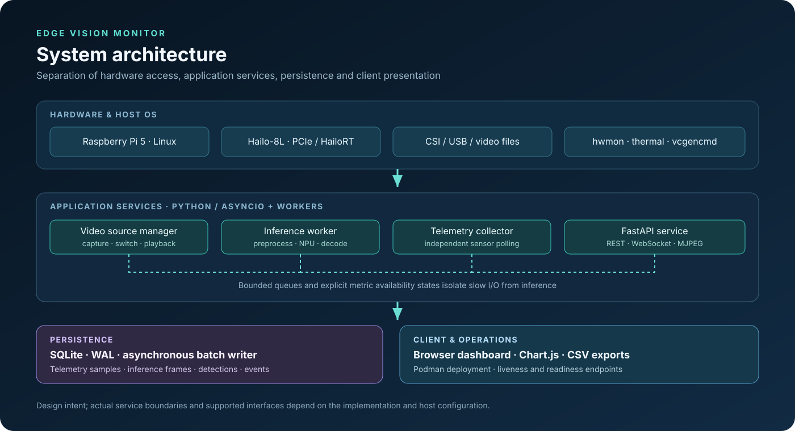

# Edge Vision Monitor: Deployment & Operations Guide

This guide covers physical hardware assembly, host OS configuration, least-privilege Podman containerisation, systemd service management, and operational maintenance for the **Edge Vision Monitor** platform.

<p align="center">
  
</p>

---

## 1. Hardware Assembly & Physical Setup

### 1.1 Hailo-8L AI HAT+ Installation
1. **Power Off**: Ensure the Raspberry Pi 5 is completely disconnected from power.
2. **Mount Standoffs**: Secure the four 16mm brass standoffs onto the Raspberry Pi 5 mounting holes.
3. **FPC Ribbon Connection**:
   - Gently pull up the locking collar on the Raspberry Pi 5 PCIe FPC connector.
   - Insert the flexible printed circuit (FPC) ribbon with contacts facing towards the USB/Ethernet ports.
   - Press down the locking collar to secure the ribbon.
   - Insert the other end of the ribbon into the AI HAT+ connector, ensuring the cable is fully seated and straight.
4. **Fasten HAT**: Align the HAT+ over the GPIO header and standoffs, then secure with the provided screws.
5. **Connect Peripherals**: Attach the active cooling fan and camera cables (CSI ribbon or USB).

### 1.2 Enable PCIe Gen 3 in Firmware
For maximum NPU throughput (up to 8 Gbps):
1. Open `/boot/firmware/config.txt` in a text editor:
   ```bash
   sudo nano /boot/firmware/config.txt
   ```
2. Append the following parameters under `[all]`:
   ```ini
   # Enable PCIe connector
   dtparam=pciex1

   # Enable PCIe Gen 3 transfer speeds
   dtparam=pciex1_gen=3
   ```
3. Save the file and reboot the Raspberry Pi 5:
   ```bash
   sudo reboot
   ```
4. Verify PCIe link operation:
   ```bash
   lspci -vv -d 1e60:
   # Look for: LnkSta: Speed 8GT/s, Width x1
   ```

---

## 2. Host Operating System & Drivers

### 2.1 Install Hailo Drivers & Software Stack
On Raspberry Pi OS 64-bit (Debian Bookworm):
```bash
sudo apt update
sudo apt install -y hailo-all v4l-utils python3-pip python3-venv
```

Verify that the kernel co-processor driver loaded:
```bash
# Check device node
ls -l /dev/hailo0
# Output should show: crw-rw---- 1 root video ... /dev/hailo0

# Verify driver sysfs tree
ls /sys/bus/pci/drivers/hailo_pci
```

### 2.2 User Permissions
Ensure the operational user belongs to the `video` and `i2c` groups:
```bash
sudo usermod -aG video,i2c $USER
# Log out and log back in for group changes to take effect
groups
```

---

## 3. Podman Container Deployment

Podman is the recommended deployment engine, offering rootless execution and fine-grained device isolation without `--privileged`.

### 3.1 Directory Structure on Host
Organise persistent data and configuration on the host:
```bash
mkdir -p /opt/edge-vision-monitor/{config,data,models,media}
cd /opt/edge-vision-monitor
```

### 3.2 Podman Compose Configuration
Create `compose.yaml`:
```yaml
version: "3.8"

services:
  edge-vision-monitor:
    build:
      context: .
      file: Containerfile
    image: edge-vision-monitor:latest
    container_name: edge-vision-monitor
    restart: unless-stopped
    network_mode: host

    # Least-privilege device pass-through
    devices:
      - "/dev/hailo0:/dev/hailo0:rwm"
      - "/dev/video0:/dev/video0:rwm"

    # Volume mounts with SELinux/Podman :Z security flags
    volumes:
      - "/sys/class/hwmon:/sys/class/hwmon:ro"
      - "/sys/class/thermal:/sys/class/thermal:ro"
      - "./data:/app/data:Z"
      - "./models:/app/models:ro,Z"
      - "./media:/app/media:ro,Z"
      - "./config/config.yaml:/app/config/config.yaml:ro,Z"

    environment:
      - EVM_SERVER__HOST=0.0.0.0
      - EVM_SERVER__PORT=8000
      - EVM_SERVER__LOG_LEVEL=INFO

    healthcheck:
      test: ["CMD", "curl", "-f", "http://localhost:8000/api/v1/health"]
      interval: 15s
      timeout: 5s
      retries: 3
      start_period: 10s
```

### 3.3 Deploying and Managing the Container
```bash
# Build the container image
podman-compose build

# Start container in detached mode
podman-compose up -d

# Inspect health status
podman inspect --format='{{.State.Health.Status}}' edge-vision-monitor

# View operational logs
podman-compose logs -f
```

---

## 4. Production systemd Service

For native host installations that run 24/7 automatically on boot:

### 4.1 Automated systemd Setup via `main.py`
The project provides automated systemd integration directly from the root entry point:
```bash
# Preview generated service unit
python main.py systemd show

# Install service, reload daemon, and enable at boot
python main.py systemd install --start-now

# Manage service lifecycle
python main.py systemd status
python main.py systemd logs -n 50
python main.py systemd restart
python main.py systemd stop

# Uninstall service
python main.py systemd uninstall
```

### 4.2 Manual Service Unit Specification
Alternatively, create `/etc/systemd/system/edge-vision-monitor.service` manually:
```ini
[Unit]
Description=Edge Vision Monitor Platform
After=network.target local-fs.target
Wants=network-online.target

[Service]
Type=simple
User=mosud
Group=video
WorkingDirectory=/home/mosud/Documents/dev/edge-vision-monitor
Environment="PATH=/home/mosud/Documents/dev/edge-vision-monitor/.venv/bin:/usr/local/bin:/usr/bin"
Environment="EVM_CONFIG_PATH=/home/mosud/Documents/dev/edge-vision-monitor/config/config.yaml"
Environment="EVM_SERVER__HOST=0.0.0.0"
Environment="EVM_SERVER__PORT=8000"
ExecStart=/home/mosud/Documents/dev/edge-vision-monitor/.venv/bin/python /home/mosud/Documents/dev/edge-vision-monitor/main.py run
Restart=always
RestartSec=5s
TimeoutStopSec=15s
KillSignal=SIGTERM

# Hardening
ProtectSystem=full
ReadWritePaths=/home/mosud/Documents/dev/edge-vision-monitor

[Install]
WantedBy=multi-user.target
```

Enable and start manually:
```bash
sudo systemctl daemon-reload
sudo systemctl enable edge-vision-monitor
sudo systemctl start edge-vision-monitor
sudo systemctl status edge-vision-monitor
```

---

## 5. Maintenance, Upgrades & Backups

### 5.1 Database Backups
SQLite uses Write-Ahead Logging (`WAL`). To make a safe hot backup without pausing inference:
```bash
# Safely snapshot the SQLite database using the SQLite backup API
sqlite3 data/telemetry.db ".backup data/telemetry_backup_$(date +%F).db"
```

### 5.2 Application Upgrades
To upgrade the application code:
```bash
# 1. Stop service
sudo systemctl stop edge-vision-monitor

# 2. Pull latest release
git pull origin main

# 3. Update virtual environment
source .venv/bin/activate
pip install -e ".[dev]"

# 4. Verify test suite
pytest -v

# 5. Restart service
sudo systemctl start edge-vision-monitor
```
