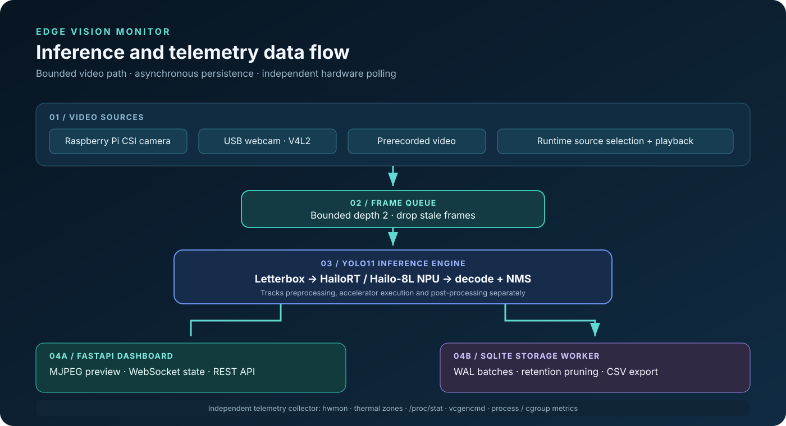

<p align="center">
  
</p>

# Edge Vision Monitor: User Guide

Welcome to the **Edge Vision Monitor** user guide. This document provides comprehensive operational instructions for interacting with the live dashboard, monitoring hardware thermals, configuring video inputs, and managing edge AI object detection workflows on the Raspberry Pi 5 equipped with a Hailo-8L AI HAT+.

---

## 1. System Overview

`edge-vision-monitor` is an edge AI monitoring platform designed for continuous computer vision execution. Unlike benchmarking scripts that operate over fixed, artificial windows, this platform provides an always-on operational service that:
- Executes YOLO11 object detection accelerated by the **Hailo-8L neural processing unit (NPU)** or CPU (ONNX Runtime).
- Streams live, annotated video previews with low overhead.
- Samples host thermals, RP1 temperatures, clock frequencies, power metrics, and firmware throttling states.
- Persists historical telemetry and detection records into an embedded **SQLite** database using Write-Ahead Logging (`WAL`).
- Exposes an interactive, modern web dashboard with real-time **WebSocket** updates and **Chart.js** historical trends.

<p align="center">
  
</p>

---

## 2. Navigating the Web Dashboard

The web dashboard is served directly by the embedded FastAPI server at `http://<device-ip>:8000/`. It adapts smoothly across desktop monitors, field tablets, and mobile browsers.

```
┌──────────────────────────────────────────────────────────────────────────────────┐
│ ⚡ EDGE VISION MONITOR        [Hailo-8L: Online] [YOLO11: READY] [Source: usb]   │
│ ──────────────────────────────────────────────────────────────────────────────── │
│ ⚠️  Warning: Hardware under-voltage detected! (Alert banner when throttled)       │
│ ──────────────────────────────────────────────────────────────────────────────── │
│ ┌────────────────────────────────────┐  ┌──────────────────────────────────────┐ │
│ │  LIVE ACCELERATED PREVIEW          │  │  HARDWARE THERMALS                   │ │
│ │  [FPS: 28.4] [NPU: 4.8 ms] [Obj: 3]│  │  CPU: 58.2°C  RP1: 52.1°C  NPU: 54°C │ │
│ │                                    │  ├──────────────────────────────────────┤ │
│ │                                    │  │  SYSTEM RESOURCES                    │ │
│ │                                    │  │  CPU: 18.2%   RAM: 32.4%   Disk: 42% │ │
│ │  [Tab: File] [Tab: USB] [Tab: CSI] │  ├──────────────────────────────────────┤ │
│ └────────────────────────────────────┘  │  PIPELINE LATENCY (p95)              │ │
│ ┌────────────────────────────────────┐  │  Pre: 1.4ms  NPU: 4.8ms  Post: 0.9ms │ │
│ │  IDENTIFIED DETECTIONS (3)         │  ├──────────────────────────────────────┤ │
│ │  • Person   [92%] (0.12, 0.20, ...)│  │  ELECTRICAL & THROTTLING             │ │
│ │  • Bicycle  [84%] (0.45, 0.60, ...)│  │  Undervoltage: No  Capped: No        │ │
│ └────────────────────────────────────┘  └──────────────────────────────────────┘ │
│ ──────────────────────────────────────────────────────────────────────────────── │
│ [Chart: Latency History] [Chart: FPS] [Chart: Thermals] [Chart: System Load]    │
└──────────────────────────────────────────────────────────────────────────────────┘
```

### 2.1 Header & Status Indicators
Located along the top navigation bar:
- **Brand Identifier**: Displays platform branding and host architecture.
- **Hailo-8L Badge**:
  - `Green ("Hailo-8L: Online")`: The PCIe accelerator `/dev/hailo0` is detected, configured, and actively running.
  - `Cyan ("Hailo-8L: Mock Mode")`: Running in mock mode on non-Hailo development workstations.
  - `Amber ("Hailo-8L: Missing")`: Hardware device is disconnected or driver is uninitialised.
- **YOLO11 Model Badge**: Displays the compilation state of the active model (e.g. `READY`, `CONFIG_ERROR`, or `MOCK_READY`).
- **Input Source Badge**: Indicates the active video modality and source identifier (e.g. `usb:/dev/video0`, `picamera:0`, or `file:traffic.mp4`).
- **Backend Switcher Controls**: Segmented toggles (`[🚀 Hailo-8L]` and `[💻 CPU (ONNX)]`) enabling live dynamic switching between the PCIe NPU accelerator and CPU inference (ONNX Runtime) without restarting the service.
- **Master Inference Toggle**: Button allowing operators to safely halt or resume the continuous inference worker thread without interrupting web services.
- **Diagnostics Button**: Opens the hardware inventory and data provenance modal.

### 2.2 Alert Banner
When Raspberry Pi firmware throttling is detected via `vcgencmd get_throttled`, an amber and red animated alert banner appears below the header:
- **Under-voltage Warning**: Indicates the host 5V power supply cannot maintain the required voltage under heavy NPU and CPU loads.
- **Thermal Throttling**: Indicates the SoC temperature has exceeded 80°C and clock frequencies have been capped.

---

## 3. Video Input Management & Controls

The dashboard provides dynamic, non-destructive source switching:

### 3.1 Prerecorded Video Files & Direct Upload
- Click the **Video File** tab.
- **Select Video**: Choose any compatible video (`.mp4`, `.avi`, `.mkv`, `.mov`) located in the `media/` directory from the dropdown.
- **Direct Web Upload**: Click **Upload Video** to upload local MP4 or AVI footage directly into the server's `media/` folder via browser without needing SSH or SCP.
- **Playback Controls**:
  - `⏸` (Pause): Temporarily pauses video playback while maintaining camera engine state.
  - `▶` (Play): Resumes video playback at native video FPS.
  - `↺` (Restart): Rewinds playback to the beginning of the media file.
- **Synthetic Mode**: If no video files are present, the system automatically runs a procedural synthetic edge stream featuring moving targets, ensuring operational verification is always possible.

### 3.2 USB Webcams
- Click the **USB Camera** tab.
- Select the detected V4L2 device node (e.g. `/dev/video0` or `/dev/video2`).
- The system automatically configures capture resolution (default: 640×480) and frame rate (30 FPS).
- If the camera is unplugged during operation, the worker initiates automated reconnection attempts with exponential backoff.

### 3.3 Raspberry Pi Camera Module (CSI)
- Click the **Pi Camera (CSI)** tab and select **Activate CSI Camera**.
- Communicates directly with the sensor through `Picamera2` and host `libcamera`.
- If another process is holding the camera device, or if permissions are missing, an informative diagnostic message is displayed.

---

## 4. Live Visualisation & Detections

### 4.1 Heads-Up Display (HUD)
Overlaid directly onto the live stream viewport:
- **FPS**: Processed frames per second calculated over recent evaluation windows.
- **Hailo / CPU**: Dedicated neural compute execution latency in milliseconds, dynamically reflecting whether the Hailo-8L NPU (~14 ms) or CPU ONNX Runtime (~173 ms) is active.
- **Objects**: Current object count in the active frame.

### 4.2 Snapshot & Fullscreen
- **Snapshot (`📸`)**: Opens the raw, full-resolution annotated JPEG frame in a new browser tab.
- **Fullscreen (`⛶`)**: Expands the live video viewport to fill the entire monitor.

### 4.3 Detections Feed
The panel beneath the video preview displays each identified object:
- **Class Label**: Human-readable name (e.g. `person`, `car`, `traffic light`).
- **Colour Coding**: Distinct high-contrast palette tags corresponding to bounding boxes.
- **Confidence Meter**: Visual bar and percentage (e.g. `88%`).
- **Coordinates**: Normalised bounding box coordinates `[xmin, ymin, xmax, ymax]`.

---

## 5. Telemetry & Hardware Health Gauges

Hardware metrics are sampled every second on an isolated thread:

### 5.1 Hardware Thermals
- **CPU Temperature**: Primary SoC temperature in degrees Celsius with colour-coded thresholds:
  - `< 70°C`: Cyan (Nominal)
  - `70°C - 79°C`: Amber (Elevated)
  - `≥ 80°C`: Red (Critical: throttling imminent)
- **RP1 I/O Controller**: Measures temperature of the Raspberry Pi 5 southbridge chip.
- **Hailo-8L Die**: Silicon temperature of the accelerator co-processor.

### 5.2 System Resources
- **CPU Utilisation**: Accurate delta percentage derived from successive `/proc/stat` counter reads.
- **RAM Utilisation**: Memory consumption percentage calculated against `/proc/meminfo`.
- **Disk Utilisation**: Remaining capacity on the persistent storage partition.

### 5.3 Pipeline Latency Breakdown
Visualises latency across three distinct stages:
1. **Preprocessing (`Pre`)**: Letterbox resizing, aspect ratio preservation padding, and colour conversion.
2. **Hailo Execution (`NPU`)**: Pure on-chip accelerator execution time measured by monotonic clock.
3. **Post-processing (`Post`)**: YOLO head decoding, vectorised Non-Maximum Suppression (IoU: 0.45), and coordinate unletterboxing.

---

## 6. Historical Telemetry & Analytics Charts

Four interactive **Chart.js** plots track trends over time:
1. **Latency Breakdown History**: Stacked latency comparison (Pre, NPU, Post) to quickly identify pipeline bottlenecks.
2. **Inference FPS History**: Verifies steady-state throughput under sustained operational loads.
3. **Thermal Profile History**: Multi-line tracking of CPU, RP1, and Hailo NPU thermals.
4. **System Utilisation History**: Combined host CPU and RAM utilisation load percentages.

---

## 7. Diagnostics & Dataset Export

Click **Diagnostics (`🔧`)** in the header to open the diagnostic modal:
- **Target System Overview**: Confirms hostname, OS kernel, CPU architecture, `/dev/hailo0` device presence, and HailoRT driver bindings.
- **Sensor Catalogue**: Comprehensive table of every discovered sensor, normalised measurement unit, driver provenance, and availability status.
- **Export Telemetry CSV**: Downloads all historical temperature, power, resource, and throttling records as a CSV spreadsheet.
- **Export Detections CSV**: Downloads structured detection history, including timestamps, frame numbers, class names, confidence scores, and bounding boxes.
